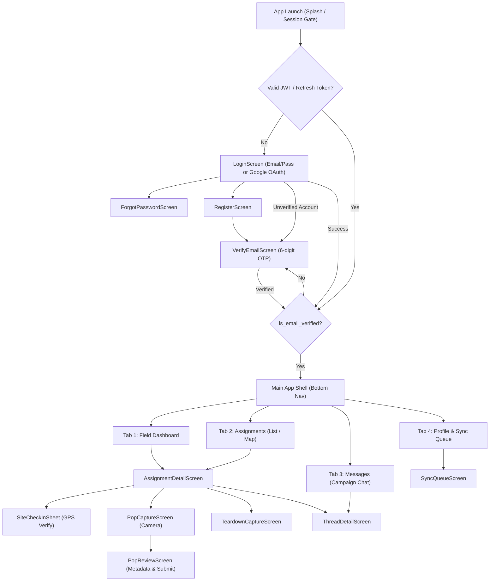
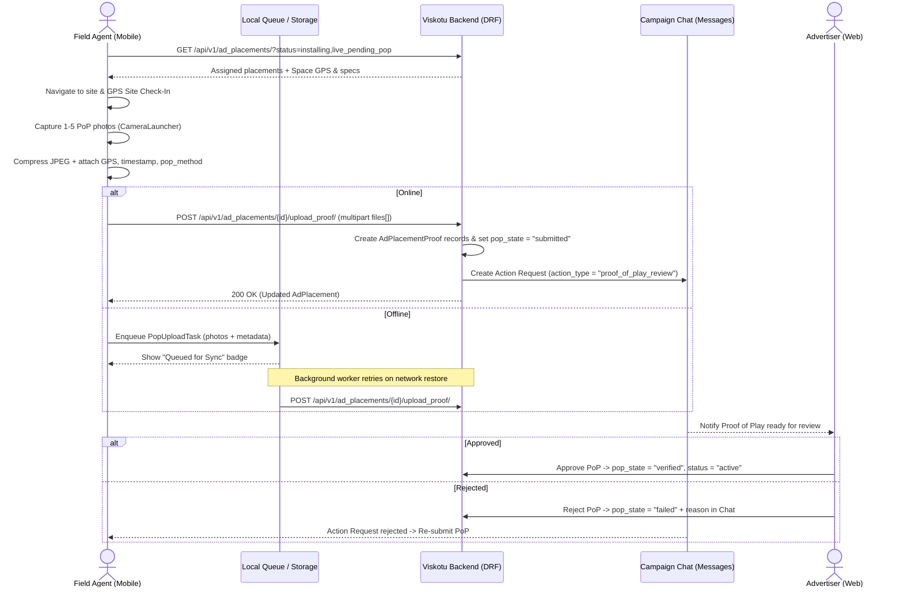
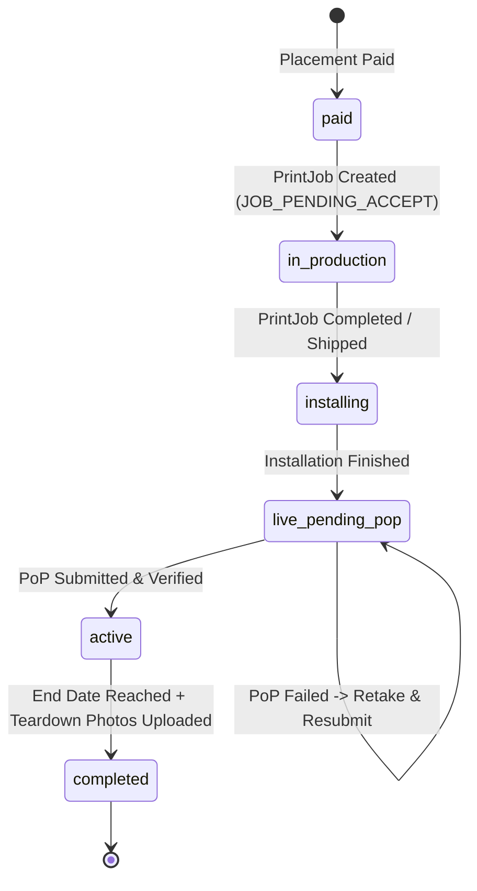
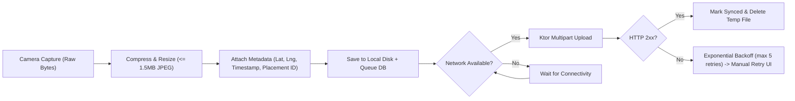

# Viskotu Mobile — Functional Requirements Document (FRD)

**Version:** 1.0  
**Date:** 2026-11-23  
**Platform:** Kotlin Multiplatform + Compose Multiplatform (Android, iOS, Desktop JVM)  
**Primary Users:** Field Agents, Installers, Production Partners & Self-Fulfilling Space Owners  
**Backend Reference:** `viskotu-backend` (Django REST Framework, API v1)

---

## 1. Executive Summary & Product Scope

**Viskotu Mobile** is the field-operations companion app for the Viskotu physical advertising marketplace. While the web platform (`viskotu-frontend`) handles marketplace discovery, campaign booking, billing, and admin operations, Viskotu Mobile is purpose-built for **on-site execution**:

- **Site Check-In:** Navigating to physical ad spaces and verifying installer presence via GPS coordinates.
- **Proof of Play (PoP) Capture:** Taking timestamped, geotagged installation photos and submitting them for advertiser/host verification.
- **Campaign & PrintJob Verification:** Tracking installation milestones, accepting/updating production jobs, and resolving rejected proofs.
- **Teardown Verification:** Capturing post-campaign removal photos to formally close out placements.
- **Offline-First Resilience:** Queuing photos and check-ins in low-signal field environments (underground transit, highways, rural billboards) and syncing automatically when connectivity returns.

### In Scope (v1.0)
- Email/password + Google OAuth authentication, 6-digit OTP email verification, password reset, JWT auto-refresh.
- Role-aware Field Dashboard & Assignment List (`AdPlacement` and `PrintJob` workflows).
- Site Detail view with specs, reference photos, GPS navigation deep link, and geofenced Site Check-In.
- Multi-photo Proof of Play (PoP) capture, review, watermark/metadata attachment, and upload.
- Teardown photo capture & placement completion.
- Campaign Chat viewing & PoP rejection/re-submission loop.
- Offline capture queue with automatic retry.

### Out of Scope (v1.0)
- Creating/editing Ad Space listings (Web only).
- Campaign creation, media buying, and P2P payment/checkout flows (Web only).
- Admin SLA management, payouts, and user moderation (Web only).

---

## 2. User Roles & Backend Alignment

In `viskotu-backend` (`apps/users/models.py`), `User.ROLE_CHOICES` currently defines:
- `production-partner` — Print & installation partners assigned to `PrintJob`s; permitted to call `POST /api/v1/ad_placements/{id}/upload_proof/` via `IsSpaceOwnerOrPrinter`.
- `space-owner` — Hosts who self-fulfill installations; permitted to call `upload_proof/` and `complete/` (teardown).
- `advertiser` & `admin` — Web-primary roles (not primary mobile personas).

> [!IMPORTANT]
> **Role Gap Identified:** `viskotu-backend` does not yet have a dedicated `field-agent` role. In v1.0, field installers authenticate as `production-partner` or `space-owner` (or delegated team members via `/api/v1/users/managed-access/`). Section 6 documents the recommended backend additions for dedicated field-agent delegation.

| Persona | Backend Role | Mobile Capabilities |
| :--- | :--- | :--- |
| **Field Installer (Partner Staff)** | `production-partner` | Accept/reject/progress `PrintJob`s, check in on site, capture & upload Proof of Play, view Campaign Chat |
| **Self-Fulfilling Host** | `space-owner` | View placements needing install/PoP/teardown, check in on site, upload Proof of Play, submit teardown & mark `completed` |
| **Dedicated Field Agent (Phase 2)** | `field-agent` (new) / `ManagedAccess` | Scoped to assigned placements only (no billing/payout visibility); check-in, PoP, teardown, chat |

---

## 3. End-to-End Flow Diagrams

### 3.1 App Navigation & Authentication Flow



### 3.2 Proof of Play (PoP) Submission & Verification Sequence



### 3.3 Placement & PrintJob Lifecycle State Machine



### 3.4 Offline-First Capture & Sync Pipeline



---

## 4. Screen-by-Screen Breakdown

Each screen lists its **Current Implementation Status** in `viskotu-mobile`, its **UI Composition**, and its **MVI Contract** (`State`, `Intent`, `Effect`).

### 4.1 Authentication & Onboarding

| Screen | Route | Current Status | Notes |
| :--- | :--- | :--- | :--- |
| **Splash / Session Gate** | `splash` | New | Reads stored JWT, refreshes via `/api/v1/auth/refresh/`, routes to `login`, `verify_email`, or `dashboard` |
| **Login** | `login` | Built (Mock VM) | `LoginScreen.kt` — replace `delay(1500)` with real `/api/v1/auth/login/` & `/api/v1/auth/google/` |
| **Register** | `register` | Built (Unwired) | `RegisterScreen.kt` — wire into `NavHost` + `/api/v1/auth/signup/` |
| **Verify Email** | `verify_email/{email}` | Built (Unwired) | `VerifyEmailScreen.kt` — 6-digit OTP via `/api/v1/auth/verify-email/` & `/resend-verification/` |
| **Forgot Password** | `forgot_password` | Built (Unwired) | `ForgotPasswordScreen.kt` — wire to `/api/v1/auth/password-reset/` |

---

### 4.2 Tab 1 — Field Dashboard (`DashboardScreen`)
- **Route:** `dashboard`  
- **Current Status:** Stubbed (`DashboardScreen.kt` currently has a single camera button).
- **Purpose:** Give field agents an immediate view of today's urgent actions, sync health, and quick PoP access.
- **UI Breakdown:**
  1. **Top Bar:** Greeting (`Hi, {first_name}`), active role pill (`Production Partner` / `Space Owner`), offline/sync status chip (`Synced` / `2 Pending Uploads` / `Offline`).
  2. **KPI Summary Strip (3 compact cards):**
     - *Due Today* (count of placements needing PoP or install today)
     - *Action Needed* (rejected PoPs or `JOB_PENDING_ACCEPT` expiring soon)
     - *Completed (This Week)*
  3. **Urgent / Next Up Card:** Highlighted card for the most time-sensitive assignment with countdown (`accept_deadline` or `start_date`), space address, and 1-tap **"Open & Capture PoP"** CTA.
  4. **Today's Schedule List:** Compact cards showing Space Name, Campaign Name, Status badge (`installing`, `live_pending_pop`, `pop_failed`), distance from user (when GPS enabled).
  5. **Pull-to-Refresh** & empty state ("All caught up for today").
- **MVI Contract:**
  - **State:** `user`, `isOffline`, `pendingSyncCount`, `kpis`, `urgentItem`, `todayItems`, `isLoading`, `error`
  - **Intents:** `OnRefresh`, `OnAssignmentClicked(id)`, `OnQuickCaptureClicked(placementId)`, `OnSyncBannerClicked`
  - **Effects:** `NavigateToDetail(id)`, `NavigateToPopCapture(placementId)`, `NavigateToSyncQueue`

---

### 4.3 Tab 2 — Assignments List (`AssignmentsScreen`)
- **Route:** `assignments`
- **Current Status:** New
- **Purpose:** Full searchable, filterable list of assigned `AdPlacement`s and `PrintJob`s.
- **UI Breakdown:**
  1. **Search Bar:** Filter by space name, city/address, campaign title, or placement ID.
  2. **Filter Chips (Horizontal Scroll):**
     - `All`
     - `Needs PoP` (`status=live_pending_pop` or `pop_state=awaiting`)
     - `PoP Rejected` (`pop_state=failed`)
     - `Installing` (`status=installing`)
     - `Print Jobs` (`JOB_PENDING_ACCEPT`, `JOB_PREP`, `JOB_PRINTING`, `JOB_QA`, `JOB_SHIPPING`)
     - `Teardown Due` (`status=active` & `end_date <= today + 2d`)
     - `Completed`
  3. **Assignment Card:**
     - Space thumbnail (`reference_photo` / primary `SpacePhoto`)
     - Space name + city/address
     - Campaign name & flight dates (`start_date` – `end_date`)
     - Status badge + PoP state pill (`Awaiting`, `Submitted`, `Verified`, `Failed`)
     - If `PrintJob`: priority badge (`urgent`, `high`, `medium`, `low`) & `accept_deadline` countdown
- **MVI Contract:**
  - **State:** `query`, `selectedFilter`, `items`, `isLoading`, `isRefreshing`, `error`
  - **Intents:** `OnQueryChanged`, `OnFilterSelected`, `OnRefresh`, `OnItemClicked(id)`
  - **Effects:** `NavigateToDetail(id)`

---

### 4.4 Assignment / Site Detail (`AssignmentDetailScreen`)
- **Route:** `assignment/{placementId}`
- **Current Status:** New
- **Purpose:** Complete operational brief for a single physical ad site so the installer has everything needed on location.
- **UI Breakdown:**
  1. **Header & Status Banner:** Space name, placement status badge, `pop_state` badge. If `pop_state == "failed"`, show a prominent red alert banner with the rejection reason from Campaign Chat.
  2. **Location & Check-In Card:**
     - Full address, `facing_direction`, `primary_roads`, GPS coordinates (`latitude`, `longitude`).
     - **"Open in Maps"** button (launches native Apple Maps / Google Maps directions).
     - **"Site Check-In"** button (opens `SiteCheckInSheet`; shows verified green badge with timestamp & distance once checked in).
  3. **Installation & Creative Specs Card:**
     - Dimensions (`width × height`), `orientation`, `physical_shape`, `material`, `min_dpi`.
     - `reference_photo` (tap to zoom fullscreen) & `designer_notes`.
     - Required `proof_of_play_method` (e.g., *Photo with Timestamp & GPS*).
  4. **PrintJob Workflow Card** *(shown if user is `production-partner` and `print_job` exists)*:
     - Current job status stepper (`Pending Accept` → `Prep` → `Printing` → `QA` → `Shipping` → `Completed`).
     - If `JOB_PENDING_ACCEPT`: **"Accept Job"** (`POST /jobs/{id}/accept/`) and **"Reject / Reroute"** (`POST /jobs/{id}/reject/`) buttons with confirmation dialog.
     - Otherwise: **"Advance Status"** action (`POST /jobs/{id}/update_status/`) + interactive `checklist` items.
  5. **Submitted Proofs Gallery:** Thumbnails of existing `AdPlacementProof` photos with timestamps (tap to fullscreen).
  6. **Sticky Bottom Action Bar:**
     - Primary CTA adapts to state:
       - `installing` / `live_pending_pop` / `pop_failed` → **"Capture Proof of Play"**
       - `active` (near/past `end_date`, Space Owner) → **"Capture Teardown & Complete"**
       - `submitted` → **"Add More Proof Photos"** (secondary)
     - Secondary icon button: **"Campaign Chat"** (jumps to `ThreadDetailScreen`).
- **MVI Contract:**
  - **State:** `placement`, `printJob`, `checkInRecord`, `isLoading`, `isUpdatingJob`, `error`
  - **Intents:** `OnOpenMaps`, `OnStartCheckIn`, `OnAcceptJob`, `OnRejectJob`, `OnUpdateJobStatus(status)`, `OnStartPopCapture`, `OnStartTeardown`, `OnOpenChat`
  - **Effects:** `LaunchExternalMaps(lat, lng)`, `OpenCheckInSheet`, `NavigateToPopCapture`, `NavigateToTeardown`, `NavigateToChat(threadId)`, `ShowSnackbar(msg)`

---

### 4.5 Site Check-In Bottom Sheet (`SiteCheckInSheet`)
- **Route:** Modal over `AssignmentDetailScreen`
- **Current Status:** New
- **Purpose:** Verify the installer is physically at the ad space before or during installation.
- **UI Breakdown:**
  1. Live GPS accuracy indicator + calculated distance from `Space.latitude`/`longitude` (Haversine distance).
  2. **Within geofence (≤ 200m):** Green *"On Site — 34m from target"* state → **"Confirm Check-In"** CTA.
  3. **Outside geofence (> 200m):** Amber warning *"You appear to be 650m away"* → **"Retry GPS"** or **"Check In Anyway (Add Reason)"** (requires short note, e.g., *"GPS pin is at mall entrance, billboard is on east wing"*).
  4. Stores check-in record locally (and attaches to PoP submission / future `/check-in/` endpoint).

---

### 4.6 Proof of Play Capture & Review (`PopCaptureScreen` & `PopReviewScreen`)
- **Routes:** `pop_capture/{placementId}` → `pop_review/{placementId}`
- **Current Status:** Partial (`CameraLauncher` `expect`/`actual` exists; needs multi-shot workflow, EXIF/GPS metadata, compression, and review screen).
- **Purpose:** Guided, tamper-resistant photo capture for Proof of Play.
- **UI Breakdown — Capture & Checklist:**
  1. **Guided Shot Prompts:** Recommended shots checklist (e.g., *1. Wide Context Shot showing surroundings*, *2. Straight-on Creative Shot*, *3. Close-up / Mounting Detail*). Minimum 1 photo required, up to 5 photos.
  2. **Camera Trigger:** Uses platform camera (`CameraLauncher`) — **camera-only by default** (disables gallery pick for PoP integrity unless `pop_method` allows it).
  3. **Live Capture Strip:** Shows captured thumbnails with delete/retake icons + **"Review & Submit (N photos)"** CTA.
- **UI Breakdown — Review & Submit (`PopReviewScreen`):**
  1. **Photo Carousel:** Swipeable previews with burned-in or displayed metadata badge (`Lat/Lng`, `UTC + Local Timestamp`, `Space Name`).
  2. **PoP Method Selector:** Pre-filled from `Space.proof_of_play_method` / `/api/v1/core/taxonomy/` (`proof_of_play_method`).
  3. **Optional Installer Notes:** Free-text note (e.g., lighting conditions, obstruction warnings).
  4. **Submit CTA:**
     - Online: Uploads via `POST /api/v1/ad_placements/{id}/upload_proof/` with upload progress bar → Success confirmation screen.
     - Offline: Saves to local `SyncQueue` → Confirmation *"Saved offline — will upload automatically when online"*.
- **MVI Contract:**
  - **State:** `placementId`, `capturedPhotos: List<CapturedPhoto>`, `popMethod`, `notes`, `gpsLocation`, `uploadProgress`, `isSubmitting`, `error`
  - **Intents:** `OnTakePhoto`, `OnPhotoCaptured(bytes)`, `OnRemovePhoto(index)`, `OnPopMethodChanged`, `OnNotesChanged`, `OnSubmitProof`
  - **Effects:** `LaunchCamera`, `NavigateToSuccess`, `ShowError(msg)`

---

### 4.7 Teardown / Completion Flow (`TeardownCaptureScreen`)
- **Route:** `teardown/{placementId}`
- **Current Status:** New
- **Purpose:** Allow `space-owner` (or authorized installer) to photograph the cleared space after campaign end and mark the placement `completed`.
- **UI Breakdown:**
  - Reuses the `PopCaptureScreen` camera component with teardown-specific guidance (*"Capture the cleared ad space showing no remaining campaign material"*).
  - Submits to `POST /api/v1/ad_placements/{id}/complete/` with optional `files[]`.
  - Updates placement status to `completed`.

---

### 4.8 Tab 3 — Campaign Messages (`MessagesListScreen` & `ThreadDetailScreen`)
- **Routes:** `messages`, `messages/{threadId}`
- **Current Status:** New
- **Purpose:** Let field agents see `proof_of_play_review` Action Requests, rejection feedback, and coordinate with hosts/advertisers.
- **UI Breakdown:**
  - **Thread List:** Subject, campaign name, last message snippet, unread dot, timestamp.
  - **Thread Detail:** Message bubbles supporting all 3 backend `message_type`s:
    - `text` — Standard chat message (+ optional image attachment).
    - `system_alert` — Centered subtle status pill.
    - `action_request` — Rich card for `proof_of_play_review` showing submitted thumbnails + status pill (`Pending`, `Completed/Verified`, `Rejected`) + **"Retake Proof of Play"** shortcut if rejected.

---

### 4.9 Tab 4 — Profile & Offline Sync Queue (`ProfileScreen` & `SyncQueueScreen`)
- **Routes:** `profile`, `sync_queue`
- **Current Status:** New
- **UI Breakdown (`ProfileScreen`):**
  - User avatar, name, email, `role`, `kyc_status` badge, `reliability_score` (`/100`).
  - **Role Switcher** (if user has multiple `onboarded_roles` → `POST /api/v1/auth/switch-role/`).
  - **Offline Sync Queue** row with badge showing pending/failed uploads → opens `SyncQueueScreen`.
  - **Permissions Health:** Camera & Location permission status with deep link to OS Settings.
  - **Logout** (`POST /api/v1/auth/logout/` + clear local JWT).
- **UI Breakdown (`SyncQueueScreen`):**
  - Lists all queued PoP / Teardown / Check-In items with status (`Waiting for network`, `Uploading`, `Failed`), retry count, **"Retry All"** and per-item **"Retry" / "Discard"** actions.

---

## 5. API Integration Matrix (`viskotu-backend`)

All requests use `Authorization: Bearer <access_token>` (SimpleJWT) with automatic token refresh on HTTP `401`.

| Feature | Method & Endpoint | Request / Key Fields | Response / Side Effect |
| :--- | :--- | :--- | :--- |
| **Login** | `POST /api/v1/auth/login/` | `{ email, password }` | `access`, `refresh`, `user` |
| **Google OAuth** | `POST /api/v1/auth/google/` | `{ id_token }` / OAuth token | `access`, `refresh`, `user` |
| **Refresh Token** | `POST /api/v1/auth/refresh/` | `{ refresh }` | New `access` token |
| **Current User** | `GET /api/v1/auth/me/` | — | `User` (`role`, `is_email_verified`, `reliability_score`, `onboarded_roles`) |
| **Signup** | `POST /api/v1/auth/signup/` | `{ email, password, first_name, last_name, role }` | Sends 6-digit OTP email |
| **Verify Email** | `POST /api/v1/auth/verify-email/` | `{ email, otp_code }` | Marks `is_email_verified = true` |
| **Resend OTP** | `POST /api/v1/auth/resend-verification/` | `{ email }` | Re-sends 6-digit OTP |
| **Password Reset** | `POST /api/v1/auth/password-reset/` | `{ email }` | Sends reset instructions |
| **Switch Role** | `POST /api/v1/auth/switch-role/` | `{ role }` | Updates active user role |
| **Logout** | `POST /api/v1/auth/logout/` | `{ refresh }` | Blacklists refresh token |
| **Taxonomy** | `GET /api/v1/core/taxonomy/` | — | Includes `proof_of_play_method` options |
| **List Placements** | `GET /api/v1/ad_placements/` | `?status=...&role=space-owner` | `AdPlacement[]` with `space_detail`, `campaign_detail`, `proofs` |
| **Placement Detail** | `GET /api/v1/ad_placements/{id}/` | — | Full `AdPlacement` + `Space` GPS/specs |
| **Upload PoP** | `POST /api/v1/ad_placements/{id}/upload_proof/` | `multipart/form-data`: `files[]`, `pop_method` | Creates `AdPlacementProof`, sets `pop_state="submitted"`, posts `proof_of_play_review` in Chat |
| **Complete / Teardown** | `POST /api/v1/ad_placements/{id}/complete/` | `multipart/form-data`: optional `files[]` | Stores teardown proofs, sets `status="completed"` |
| **List PrintJobs** | `GET /api/v1/jobs/` | — | `PrintJob[]` with `ad_placement_detail`, `checklist`, `deadline`, `accept_deadline` |
| **Accept PrintJob** | `POST /api/v1/jobs/{id}/accept/` | — | `JOB_PENDING_ACCEPT` → `JOB_PREP` |
| **Reject PrintJob** | `POST /api/v1/jobs/{id}/reject/` | — | Reroutes to next `production-partner` |
| **Update Job Status** | `POST /api/v1/jobs/{id}/update_status/` | `{ status }` | Moves through `JOB_PREP` → `JOB_PRINTING` → `JOB_QA` → `JOB_SHIPPING` → `JOB_COMPLETED` |
| **List Threads** | `GET /api/v1/messages/threads/` | — | User's `Thread[]` |
| **Thread Messages** | `GET/POST /api/v1/messages/messages/` | `?thread={id}` / `{ thread, body, attachment }` | Messages including `action_request` cards |

---

## 6. Recommended Backend Additions (for Full Field-Agent Support)

To unlock the full field-agent experience beyond what `viskotu-backend` supports today, add these targeted enhancements:

1. **Proof Metadata Fields on `AdPlacementProof`:** Add `captured_at` (DateTime), `latitude`, `longitude`, `gps_accuracy_m`, `device_info`, and `notes` so PoP audits can verify where and when a photo was taken (even when uploaded hours later from the offline queue).
2. **Site Check-In Endpoint:** `POST /api/v1/ad_placements/{id}/check_in/` storing `{ latitude, longitude, accuracy_m, checked_in_at, override_reason }` and transitioning `status` from `in_production` → `installing`.
3. **Production Partner Visibility on `AdPlacementViewSet`:** Currently `AdPlacementViewSet.get_queryset()` filters by `Q(advertiser=user) | Q(space__owner=user)`. Add `| Q(print_job__production_partner=user)` so `production-partner` installers can fetch their assigned placements directly (and call `upload_proof/` without hitting 404).
4. **Dedicated `field-agent` Role / Assignment:** Either extend `User.ROLE_CHOICES` with `field-agent` or scope `ManagedAccess` delegates to assigned `AdPlacement`s / `PrintJob`s.
5. **Push Notifications (FCM / APNs):** Register device tokens (`POST /api/v1/users/devices/`) to alert field agents on new job assignments, approaching `accept_deadline`, and rejected PoPs.

---

## 7. Target Mobile Architecture (KMP Clean Architecture + MVI)

Evolve `shared/src/commonMain/kotlin/com/viskotu/app/` from its current presentation-only layout into a clean, testable 3-layer architecture:

```text
shared/src/commonMain/kotlin/com/viskotu/app/
├── core/
│   ├── network/        # Ktor HttpClient, Auth/Refresh plugin, BaseUrl config
│   ├── storage/        # Secure TokenStorage (expect/actual Keychain & EncryptedSharedPrefs)
│   ├── location/       # LocationProvider (expect/actual Android FusedLocation / iOS CoreLocation)
│   ├── camera/         # CameraManager (existing expect/actual + JPEG compression)
│   └── sync/           # Offline SyncQueue worker + ConnectivityMonitor
├── data/
│   ├── dto/            # @Serializable DTOs matching DRF serializers
│   ├── remote/         # AuthApi, PlacementApi, JobApi, MessageApi
│   ├── local/          # Local cache + PendingUploadDao (SQLDelight / Room KMP)
│   └── repository/     # Repository implementations
├── domain/
│   ├── model/          # Clean domain models (User, Placement, PrintJob, Proof, CheckIn)
│   └── repository/     # Repository interfaces
├── di/                 # Koin modules (networkModule, repositoryModule, viewModelModule)
├── designsystem/       # Existing ViskotuTheme, ViskotuColors (#FF6B35), Typography, Shapes
└── presentation/
    ├── navigation/     # AppNavHost + typed routes + BottomNavShell
    ├── components/     # ViskotuButton, ViskotuInput, StatusBadge, OfflineBanner, PhotoCard
    ├── auth/           # Login, Register, VerifyEmail, ForgotPassword + MVI
    ├── dashboard/      # Field Dashboard + MVI
    ├── assignments/    # AssignmentsList + AssignmentDetail + SiteCheckIn + MVI
    ├── pop/            # PopCapture + PopReview + TeardownCapture + MVI
    ├── messages/       # MessagesList + ThreadDetail + MVI
    └── profile/        # Profile + SyncQueue + MVI
```

---

## 8. Non-Functional Requirements

- **Offline Resilience:** All captured photos must be persisted to app-private storage immediately upon capture (never held only in RAM) so OS process death cannot lose field evidence.
- **Image Optimization:** Compress captured photos to JPEG (max 1920px long edge, 80% quality, target ≤ 1.5 MB/photo) before upload while preserving/recording capture timestamp and GPS coordinates.
- **Security:** Store JWT `access` and `refresh` tokens in Android Keystore / `EncryptedSharedPreferences` and iOS Keychain; enforce HTTPS in non-local builds; clear cached tokens on logout.
- **Performance:** Dashboard cold-start to cached data < 1.5s; camera launch < 1s; smooth 60fps scrolling on mid-range Android devices.
- **Design Consistency:** Maintain 1:1 token parity with Viskotu Web (`ViskotuColors.Primary500 = #FF6B35`, Slate neutral scale, high-contrast status pills for outdoor sunlight readability).

---

## 9. Phased Delivery Roadmap

| Phase | Milestone | Key Deliverables |
| :--- | :--- | :--- |
| **Phase 1** | **Auth, Core API & PoP MVP** | Koin DI + Ktor client with JWT refresh; wire all 4 Auth screens to real `/api/v1/auth/`; build Dashboard, Assignments List, Assignment Detail, and multi-photo PoP Capture/Review wired to `POST /ad_placements/{id}/upload_proof/`. |
| **Phase 2** | **Field Reliability (Offline + GPS + Jobs)** | `expect`/`actual` GPS `LocationProvider` + Site Check-In geofencing; local `SyncQueue` with background retry; `PrintJob` accept/reject/status progression; backend `AdPlacementViewSet` + proof metadata updates. |
| **Phase 3** | **Communication & Closeout** | Campaign Chat (`MessagesList` + `ThreadDetail` with `proof_of_play_review` cards); Teardown capture (`POST /ad_placements/{id}/complete/`); Push notifications (FCM/APNs) for urgent deadlines & PoP rejections. |
